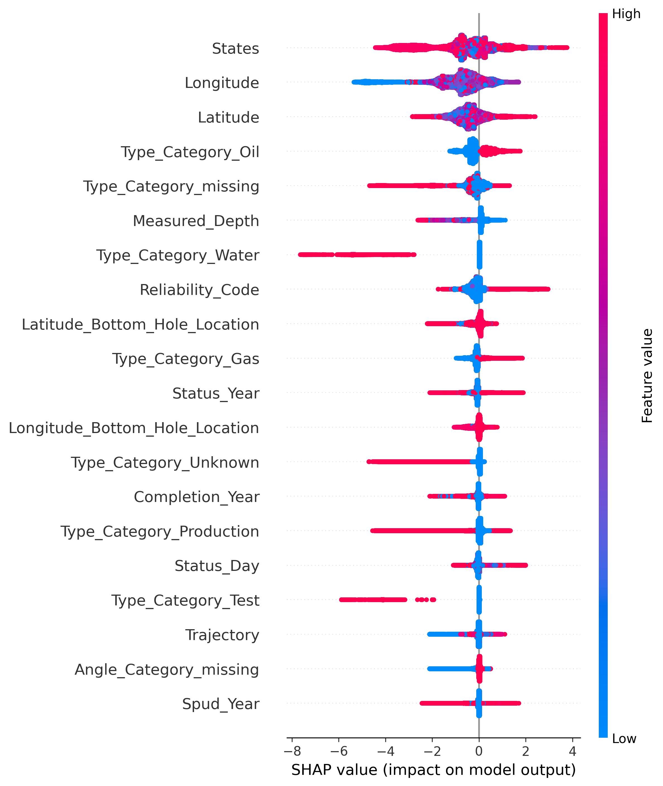

# Identifying Likely Orphaned Wells Across U.S. Basins

I developed a geospatial machine-learning workflow to identify oil and gas wells that may be orphaned, using well records collected across the United States. The purpose was to help researchers prioritize wells for further review—not to determine legal orphan status or directly estimate methane emissions.

This repository contains the original Python model script, a national SHAP example, and a basin-level validation table from an early modeling checkpoint. The underlying NETL well inventory and related source datasets are not included.

## Data and modeling scope

The broader work involved approximately **7–8 million well records**, many with missing or inconsistent fields. I worked with well status and dates, well type, depth, geographic location, land-cover categories, and basin information.

I tested modeling approaches including logistic regression and Random Forest before focusing on **XGBoost** for its ability to model nonlinear relationships in large tabular datasets. Rather than applying a single national model uniformly, I trained separate models for larger basins because reporting patterns, geology, operating history, and class prevalence varied across regions.

## How I built the model

The [original Python script](scripts/Orphan_Wells_Prediction_Final.py) documents the following workflow:

1. **Prepare records.** Read the modeling CSV, standardize state names, derive year features from status, spud, and completion dates, and handle categorical and missing values.
2. **Create a stratified holdout.** Split the records into 70% training and 30% testing before basin-specific modeling.
3. **Encode predictors.** Fit one-hot and multi-label encoders using the training partition. Categories include states, well types, angle categories, and land cover.
4. **Engineer spatial context.** Use a haversine BallTree to calculate distance to the nearest known orphan from the training inventory. The script attempts to exclude a well's own record when calculating this feature and also creates a log-distance feature and missingness indicator.
5. **Fit basin models.** Process basins with more than 100,000 training rows, using 3 or 5 stratified folds according to the minority-class count.
6. **Tune XGBoost.** Apply BayesSearchCV to tree count, depth, learning rate, row and feature sampling, regularization, and class weighting. The search optimizes average precision.
7. **Select thresholds.** Generate out-of-fold training predictions and choose a basin-specific probability threshold that maximizes F1.
8. **Evaluate holdout records.** Calculate precision, recall, F1, ROC-AUC, and PR-AUC on the held-out basin data.
9. **Explain predictions.** Generate SHAP summary plots to examine how the model features influenced its output.

The script saves model objects, performance dictionaries, classification reports, threshold plots, and SHAP figures. It is a historical research script, not a fully packaged application.

## Validation: early basin checkpoint

[View the basin holdout results](validation/early_basin_holdout_metrics.csv)

The CSV is transcribed from the **“Early basin performance”** table on slide 8 of my Understory case-study presentation. It contains 11 basin groups, including wells without an identified basin. The values are rounded as presented and **predate later fine-tuning**. They must not be represented as the final results from the current script.

| Basin | Precision | Recall | F1 | ROC-AUC | PR-AUC |
| --- | ---: | ---: | ---: | ---: | ---: |
| Appalachian | 69.6% | 59.5% | 64.2% | 94.6% | 72.2% |
| Denver | 96.9% | 93.4% | 95.1% | 99.6% | 98.3% |
| Fort Worth | 61.5% | 25.0% | 35.6% | 95.9% | 30.2% |
| Powder River | 97.6% | 96.2% | 96.9% | 99.7% | 99.3% |

These examples show why I treated the basins separately: discrimination metrics and threshold-dependent performance could differ substantially across regions.

## March basin classification reports (_HC)

I have added the 11 original basin classification reports from my March output folder to [validation/classification_reports/](validation/classification_reports/). These are the files ending in `_classification report_HC.csv`; I have not imported the similarly named reports without `_HC`, the separate `_metrics_HC.csv` files, or the threshold and SHAP plot folders.

Each report contains class 0 and class 1 precision, recall, F1, support, overall accuracy, and macro/weighted averages. For the orphaned-well class (class 1), the March reports include:

| Basin | Precision | Recall | F1 | Class 1 support |
| --- | ---: | ---: | ---: | ---: |
| Appalachian | 68.0% | 61.2% | 64.4% | 21,342 |
| Denver | 97.0% | 93.5% | 95.2% | 4,446 |
| Fort Worth | 69.2% | 28.1% | 40.0% | 32 |
| Powder River | 97.7% | 95.9% | 96.8% | 15,776 |
| Western Gulf | 92.7% | 81.3% | 86.6% | 546 |

These are directly transcribed from the `_HC` classification reports, not recalculated from predictions. They show substantial regional variation. Fort Worth, for example, has only 32 positive-class records in its test set, so overall accuracy is not an informative standalone measure of orphaned-well detection there.

The [early basin checkpoint CSV](validation/early_basin_holdout_metrics.csv) came from a separate presentation table with rounded values and should not be substituted for these original March reports. The `_HC` classification reports do not contain ROC-AUC, PR-AUC, or threshold values; those would require the separate metrics files.

## March threshold and SHAP plots

I added the 11 original `_HC` out-of-fold training threshold plots from my March output folder to [images/threshold_plots](images/threshold_plots). Each plot shows how precision, recall, and F1 change across classification thresholds. The threshold was selected using training out-of-fold predictions, before the holdout evaluation.

I also added the 11 basin-specific `_HC` SHAP summaries to [images/shap_plots](images/shap_plots). These figures complement the preliminary national SHAP example below, but represent separate basin models.

In the March class-1 classification reports, the highest precision values were Permian (99.4%), Powder River (97.7%), and Denver (97.0%), followed by Western Gulf (92.7%) and TX–LA–MS Salt (90.4%). Precision must be interpreted with recall and positive-class support: for example, Fort Worth had only 32 positive test cases and 28.1% recall.

## Model interpretation: national SHAP example



The original national SHAP summary shows the direction and distribution of feature contributions to predictions. Each point represents a well in the plotted sample. The horizontal position indicates the SHAP contribution, and color represents the feature value. The image is a **preliminary national model output** from an earlier checkpoint, not a SHAP plot generated by the basin-level script included here.

## Appalachian refinement

I also explored a separate Appalachian Basin model enriched with available Enverus attributes. The presentation describes an approximately **900,000-well** regional modeling universe, with varying Enverus coverage. The goal was to test whether adding those attributes improved classification compared with the baseline regional model. This enrichment work is described in the presentation but is not fully implemented in the script shared here.

## Running the historical script

The original file expects a local input CSV at:

```text
Raw CSV Files/ML_Ready_df/Prediction_DF_Final.csv
```

The input must include the `Orphaned` target and the fields required by the model, including `Basin_Name`, `Latitude`, `Longitude`, and `NETL_DERIVED_API`. Additional predictors must match the schema expected in the source.

Install compatible Python packages from [requirements.txt](requirements.txt), then run from the repository root:

```bash
python scripts/Orphan_Wells_Prediction_Final.py
```

The script currently sets XGBoost to `device="cuda"` and expects a compatible GPU environment. It also uses version-sensitive XGBoost and scikit-learn APIs. I have **not verified a clean end-to-end run** in a fresh environment.

### Data availability and limitations

Original access to the underlying modeling data is not available at this time. Without the original inventory and compatible package versions, I cannot reproduce the historical metrics or regenerate the model artifacts. The script is included to document my modeling methods, not as a claim that the full research pipeline can currently be rerun independently.

A few implementation details also need review before reuse, including the original missing-value treatment, possible coordinate-based duplicates in nearest-orphan features, the basin single-class guard, and whether preprocessing inside cross-validation folds fully avoids leakage. Those checks matter if this code is adapted to a new dataset.

## Repository contents

```text
Orphaned-Wells-/
├── README.md
├── requirements.txt
├── scripts/
│   └── Orphan_Wells_Prediction_Final.py
├── images/
│   ├── validation/
│   │   └── shap_summary_National.jpeg
│   ├── threshold_plots/ (11 _HC JPEGs)
│   └── shap_plots/ (11 _HC JPEGs)
├── validation/
│   ├── early_basin_holdout_metrics.csv
│   └── classification_reports/ (11 _HC CSVs)
└── portfolio/
    └── orphaned-wells.html
```

The [portfolio case study](https://jayjayanton.github.io/Website-Portfolio/projects/orphaned-wells.html) provides a more visual summary of this work.
